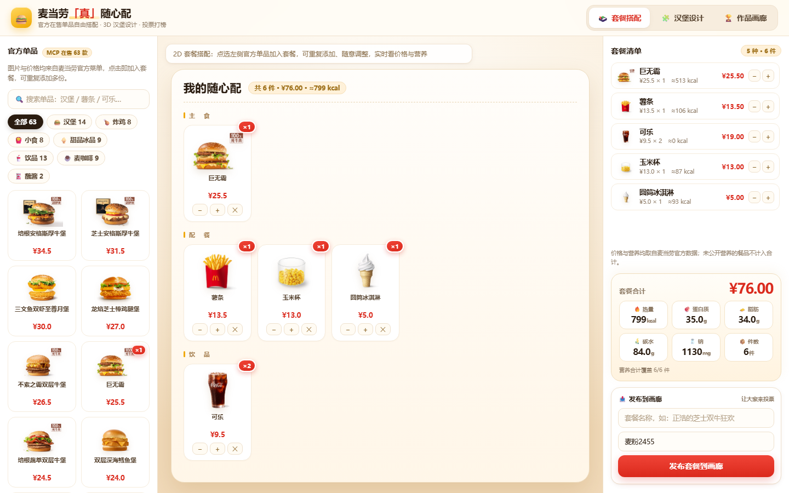
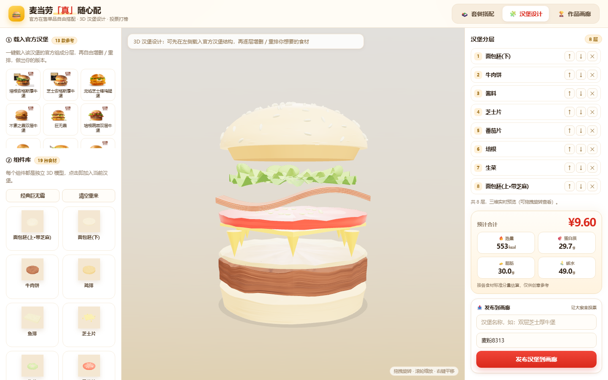
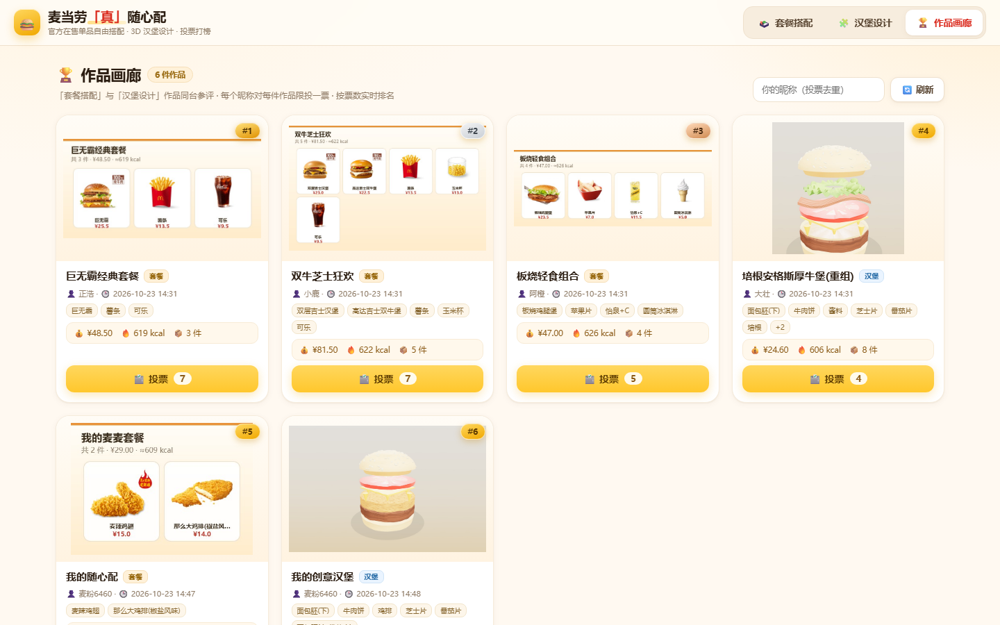
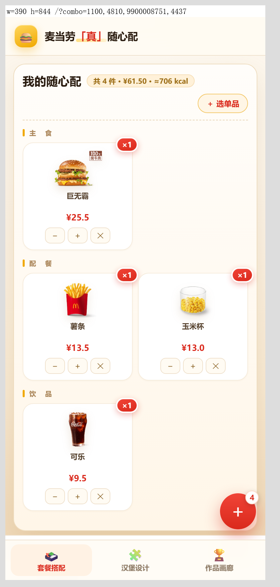
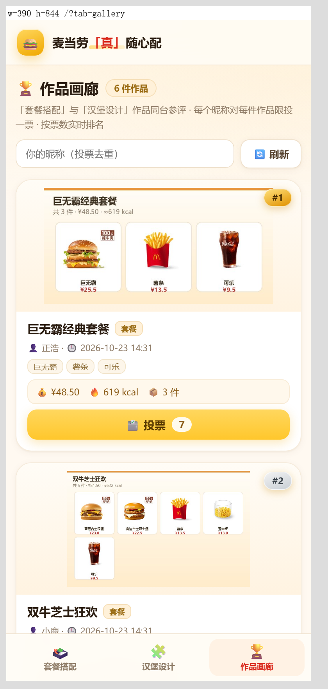
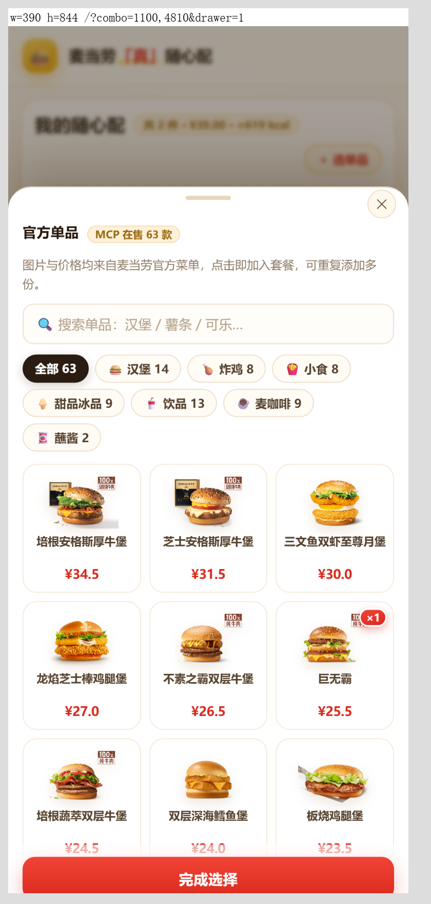

# 🍔 麦当劳「真」随心配

> **McDonald's Make-It-Your-Way** —— 用麦当劳 MCP 的真实在售菜单，把点餐变成"自由拼装 + 作品发布 + 投票打榜"的创作现场。

<p align="center">
  
</p>

<p align="center">
  <a href="#-快速开始"><b>快速开始</b></a> ·
  <a href="#-使用示例"><b>使用示例</b></a> ·
  <a href="#-麦当劳-mcp-集成"><b>MCP 集成</b></a> ·
  <a href="./MCP_INTEGRATION.md"><b>集成细节</b></a> ·
  <a href="./workbuddy.md"><b>WorkBuddy 开发记录</b></a>
</p>

---

## 📌 参赛信息

| 项 | 内容 |
|---|---|
| 参赛赛事 | 麦当劳程序员创意开发大赛（2026.10.09 – 2026.10.25） |
| 项目名称 | 麦当劳「真」随心配 |
| 作品形态 | 可运行的本地 Web 工作室 + WorkBuddy Skill（`SKILL.md`） |
| 麦当劳 MCP | `mcd-mcp`（Streamable HTTP，`https://mcp.mcd.cn`），真实调用 4 个查询类工具 |
| 开发工具 | 腾讯 **WorkBuddy**（Agent 模式全程开发，证据见 [`workbuddy.md`](./workbuddy.md)） |
| 参赛声明 | [`CONTEST_DECLARATION.md`](./CONTEST_DECLARATION.md)（官方原文，未作任何修改） |

---

## 💡 它解决什么问题

麦当劳的菜单是**固定套餐**：想换个搭配，只能"去掉生菜"或"加一片芝士"。可玩家真正想说的是——**"我想自己配"**。

- 想吃 2 个麦辣鸡腿堡 + 1 份大薯 + 2 杯可乐，但 App 里只有"麦辣鸡腿堡套餐"；
- 想知道自己这套搭配**到底多少钱、多少热量**，得逐项手动加；
- 想看看别人怎么配，没有地方展示，也没有人投票。

**麦当劳「真」随心配**把 MCP 返回的**真实在售单品**变成可自由拼装的"食材"：你随手点、系统实时算钱算营养，配完一键发布成作品，所有人同台投票打榜。所有价格、图片、营养都来自官方接口——**不是画出来的假汉堡，是今天真的能买到的东西**。

## 👥 目标用户

| 用户 | 诉求 | 本项目怎么满足 |
|---|---|---|
| **麦门玩家 / 学生党** | 想按自己口味和预算配餐，还想看别人怎么玩 | 点选即配、实时价格营养、画廊围观投票 |
| **减脂 / 控卡人群** | 想知道"这套到底多少热量"，不想踩坑 | 整份热量/蛋白/脂肪/碳水/钠聚合，缺数据如实标注不臆测 |
| **门店 / 社团 / 团建组织者** | 想办一场轻量"汉堡设计大赛" | 共享画廊 + 昵称去重投票 + 实时排名，局域网内多人同时参与 |
| **MCP 开发者** | 想找一份真实的 MCP 落地样板 | 完整可读的调用链、数据落盘、降级策略与踩坑记录 |

---

## ✨ 核心功能

### 🍱 套餐搭配（2D，官方图）

左侧货架按 **汉堡 / 炸鸡 / 小食 / 甜品冰品 / 饮品 / 麦咖啡 / 蘸酱** 分组，**63 项**可单点商品，图片全部来自 MCP 返回的官方产品图。

- 点一下加入套餐，同款可加多份（最多 9 份/项）；
- 中央托盘按 **主食 / 配餐 / 饮品** 三区分区排布，带份数角标与 `− / + / ✕`；
- 右侧逐项列出单价 × 份数、单项热量；
- 底部合计卡：**总价（含"省 ¥x"原价对比）+ 热量 / 蛋白 / 脂肪 / 碳水 / 钠 + 件数**。

> 官方未公开营养的商品标「营养暂缺」，并给出"营养覆盖 37/63 件"，**绝不编数字**。

### 🧩 汉堡设计（3D，可拆层）

- **一键载入官方结构**：14 款在售汉堡的参考分层（如巨无霸 = 顶胚 → 生菜 → 芝士 → 双层牛肉 → 酸黄瓜/洋葱 → 酱 → 底胚）；
- **19 种组件**自由增删 / 上移 / 下移：面包胚（上/下）、牛肉饼、鸡排、鱼排、板烧鸡排、麦乐鸡、芝士、生菜、番茄、洋葱、酸黄瓜、酱、培根、煎蛋、薯条、冰淇淋、派、虾、玉米；
- 3D 实时预览，鼠标拖拽旋转、滚轮缩放；右侧同步估算价格与营养。

<p align="center">
  
</p>

### 🏆 作品画廊（发布 + 投票）

- 套餐作品与 3D 汉堡作品**同台参评**；
- 发布时自动生成预览图（套餐用官方图 canvas 合成、汉堡用 3D 场景截图），服务端落盘为 `gallery/img_*.jpg`；
- 按票数实时排名，前三名带 🥇🥈🥉 徽章；
- 填昵称即可投票，**同一昵称对同一作品只能投一次**（服务端 409 拒绝）。

<p align="center">
  
</p>

### 📱 移动端

<p align="center">
  
  
  
  
</p>

≤1024px 自动切换为移动布局：顶栏只留品牌、模式切换移到底部标签栏、货架变底部抽屉（含搜索/分组/完成按钮）、右下圆形浮动按钮随时唤出货架并自动避让发布按钮、`env(safe-area-inset-*)` 适配刘海与手势条。

---

## 🚀 快速开始

### 前置：申请麦当劳 MCP Token

1. 打开麦当劳 MCP 开放平台，用手机号登录；
2. 控制台 → 「激活」→ 同意服务协议 → 复制 Token。

### 第一步：配置 MCP 连接器

把 [`mcp-config.example.json`](./mcp-config.example.json) 里的 `${MCD_MCP_TOKEN}` 换成你的真实 Token：

```json
{
  "mcpServers": {
    "mcd-mcp": {
      "type": "streamablehttp",
      "url": "https://mcp.mcd.cn",
      "headers": { "Authorization": "Bearer ${MCD_MCP_TOKEN}" }
    }
  }
}
```

**在 WorkBuddy 中**：左侧「专家·技能·连接器」→ 连接器 → 右上「自定义连接器」→ 配置 MCP → 粘贴上面的 JSON（替换 Token）→ 保存 → 在自定义连接器列表里**启用** `mcd-mcp`。
**在 Claude Desktop / 其他客户端**：写入对应客户端的 `mcpServers` 配置段即可。

### 第二步：启动工作室

```bash
# 需要 Python 3.8+，零第三方依赖（仅标准库）
python scripts/studio_server.py --port 8765
```

启动后终端会打印：

```
🍔 麦当劳「真」随心配 已启动
   本机访问：http://127.0.0.1:8765
   局域网访问：http://192.168.x.x:8765   ← 同一 WiFi 下其他人用这个投票
```

### 第三步：打开页面

浏览器访问 `http://127.0.0.1:8765/` 即可。三个标签页：**🍱 套餐搭配 / 🧩 汉堡设计 / 🏆 作品画廊**。

> 没有 Token 也能跑：仓库内置 MCP 快照（`assets/menu_snapshot_20261023.json` + `assets/materials.json`），页面直接读快照演示；需要"实时刷新菜单"时才用得上 Token。

### 可选：在 WorkBuddy 对话里直接用

仓库根目录的 `SKILL.md` 就是 WorkBuddy Skill 定义，安装后可直接说：

> 「帮我用麦当劳在售素材配一份 40 元以内的双人套餐」

Agent 会调用 `mcd-mcp` 拉真实菜单、给出搭配建议与营养合计。

### 可选：离线看板

双击 `assets/demo3d.html`，无需起服务即可看官方素材库与种子作品（纯图片，适合投屏演示）。

---

## 🎬 使用示例

### 示例 1：配一份"双人省钱套餐"（约 30 秒）

1. 打开 `http://127.0.0.1:8765/`，默认在「🍱 套餐搭配」；
2. 货架点 **巨无霸**、**麦辣鸡腿堡**、**大薯**、**可乐**；
3. 中央托盘自动按主食/配餐/饮品分区排好，右下角合计显示 **¥xx.xx / ≈xxxx kcal**；
4. 右上角「套餐名称」填「双人省钱套餐」→ 昵称填「小王」→ **📤 发布套餐到画廊**；
5. 切到「🏆 作品画廊」即可看到自己的卡片，点「👍 投票」给自己来一票。

### 示例 2：设计一款"双层芝士厚牛堡"（3D）

1. 切到「🧩 汉堡设计」；
2. 左侧点 **双层吉士汉堡** → 一键载入官方分层（顶胚/芝士/牛肉/酸黄瓜/洋葱/酱/底胚）；
3. 组件库再点两次 **牛肉饼**、一次 **培根**；
4. 中间 3D 场景拖拽旋转确认层次，右侧看价格与营养估算；
5. 填名称 → **📤 发布汉堡到画廊**，预览图自动取 3D 场景截图。

### 示例 3：办一场 5 人小比赛

1. 组织者在本机启动服务，把终端打印的**局域网地址**发到群里；
2. 每人各自配一套 → 发布（作者名写自己昵称）；
3. 大家打开「作品画廊」互相投票（同一昵称同一作品只能投一次，天然防刷）；
4. 画廊按票数实时排序，第一名带 🥇 徽章，截图即可当结果公布。

---

## 🍟 麦当劳 MCP 集成

本项目的**全部餐品信息**都来自麦当劳中国官方 MCP，没有一份手工编造的数据。

| Tool | 用途 | 真实产出的数据 |
|---|---|---|
| `query-nearby-stores` | 定位门店 | 门店 `1450713`（麦当劳上海黄浦华旭国际大厦餐厅） |
| `query-meals` | 拉在售菜单（核心） | **119 项**商品：编码 / 名称 / 官方图 / 现价 / 原价 |
| `query-meal-detail` | 取餐品官方组成 | 巨无霸、板烧、安格斯等 **14 款汉堡**的分层结构 |
| `list-nutrition-foods` | 营养数据 | 热量 / 蛋白 / 脂肪 / 碳水 / 钠 / 钙 |

调用链（真实执行，非示意）：

```
query-nearby-stores(city=上海, keyword=人民广场)
   └─► storeCode = 1450713
query-meals(storeCode=1450713, orderType=1, beType=1)
   └─► 119 项在售商品 ──► assets/menu_snapshot_20261023.json
                          └─► scripts/refresh_menu_from_mcp.py
                                ├─► 下载官方产品图 ──► assets/mcd_photos/ (127 张 PNG)
                                └─► assets/materials.json (10 组分类 + 营养关联)
list-nutrition-foods()
   └─► 营养数据 ──► 关联到 materials.json（覆盖率 37/63 可单点商品）
```

- 只有**读**操作，不涉及下单、支付、优惠券领取；
- 仓库内**不含任何真实 Token**，配置示例仅用 `${MCD_MCP_TOKEN}` 占位；
- 数据快照带抓取时间戳，可追溯。

完整调用参数、返回结构与业务价值见 **[`MCP_INTEGRATION.md`](./MCP_INTEGRATION.md)**。

---

## 🏗️ 技术架构

```
┌──────────────────────── 浏览器（零构建，纯静态） ────────────────────────┐
│  burger_components_3d.html                                              │
│   ├─ 🍱 套餐搭配：官方 PNG + DOM 托盘 + 实时聚合                         │
│   ├─ 🧩 汉堡设计：Three.js r128 + components3d.js（19 种组件几何）        │
│   └─ 🏆 作品画廊：卡片栅格 + 投票                                        │
└───────────────────────────────┬─────────────────────────────────────────┘
                                │ fetch (JSON)
┌───────────────────────────────▼─────────────────────────────────────────┐
│  scripts/studio_server.py   Python 标准库 http.server，零依赖            │
│   GET  /api/materials   素材库（mtime 缓存）                             │
│   GET  /api/gallery     作品列表（按票数排序）                            │
│   POST /api/designs     发布（校验 code/qty，预览图 dataURL → jpg 落盘）  │
│   POST /api/vote        投票（昵称去重，重复返回 409）                    │
└───────────────────────────────┬─────────────────────────────────────────┘
                                │
        ┌───────────────────────┴────────────────────────┐
        ▼                                                ▼
  gallery/gallery.json（原子写入）              assets/materials.json（MCP 快照）
```

**设计取舍**

- **零构建、零依赖**：没有 npm/webpack，Python 标准库起服务，评审拿到仓库就能跑；
- **数据与渲染解耦**：`materials.json` 是唯一数据源，换一份快照即换一版菜单；
- **不臆造数据**：缺营养就标"营养暂缺"，并把覆盖率显示出来；
- **降级可用**：MCP 不可用时读本地快照，页面照常演示。

---

## 📁 项目结构

```
mcd-burger-studio/
├── README.md                    # 本文件：介绍 / 安装 / 示例 / 目标用户
├── CONTEST_DECLARATION.md       # 参赛声明（官方原文，未改动）
├── MCP_INTEGRATION.md           # MCP Server / Tool / 调用流程 / 业务价值
├── mcp-config.example.json      # 脱敏 MCP 配置（仅环境变量占位）
├── workbuddy.md                 # WorkBuddy 开发对话上下文（专项奖励核验用）
├── REGISTRATION.md              # 报名 Issue 文案与提交自检清单
├── SKILL.md                     # WorkBuddy Skill 定义
├── LICENSE                      # MIT
├── assets/
│   ├── burger_components_3d.html  # 主应用（三标签页）
│   ├── components3d.js            # 19 种可分离汉堡组件 3D 几何库
│   ├── materials.json             # 分类素材库（MCP 快照重建，含营养关联）
│   ├── menu_snapshot_20261023.json# MCP query-meals 原始快照（119 项）
│   ├── mcp_tools_snapshot.json    # MCP 工具清单快照（35 个工具）
│   ├── meal_detail_raw.json       # query-meal-detail 原始返回（官方组成）
│   ├── official_composition.json  # 官方构造/排序规范
│   ├── mcd_photos/                # 官方产品图 127 张（427×320 透明 PNG）
│   ├── mcd_component_models/      # 组件 GLB 兜底（程序化几何优先）
│   ├── mcd_models_hq/             # A100 InstantMesh 生成的高精度 GLB（6 件，历史版本产物，留作证据）
│   ├── demo3d.html                # 离线官方图看板（双击即开）
│   └── vendor/                    # Three.js r128 + OrbitControls + GLTFLoader（本地化）
├── scripts/
│   ├── studio_server.py           # 零依赖服务（素材 / 发布 / 投票 / 预览图）
│   ├── refresh_menu_from_mcp.py   # 用 MCP 快照重建素材库并下载官方图
│   ├── seed_gallery.py            # 生成画廊种子作品
│   ├── build_materials.py         # 早期素材库构建（已被上者取代）
│   └── gen_demo3d.py              # 生成离线看板
├── gallery/                       # 作品与投票持久化 + 预览图
└── screenshots/                   # 桌面 / 平板 / 手机截图
```

---

## 🧭 数据口径与免责

- **在售口径**：以 MCP 快照为"当前官方在售"权威清单，已下架的季节限定不再进货架，避免展示买不到的商品；
- **营养口径**：优先取 `list-nutrition-foods`，缺失时按官方组成组件估算并标 `≈`，完全无源则标"营养暂缺"；
- **价格口径**：取 `query-meals` 返回的现价与原价，不做人为折扣；
- **图片口径**：全部为官方 `menu-img.mcd.cn` 链接下载的透明 PNG，无自绘/占位图；
- **免责**：本项目为参赛作品，**非麦当劳官方产品**，输出仅供创意与娱乐展示，不构成营养、医疗或任何专业建议；餐品供应、价格以麦当劳官方渠道实时结果为准。

---

## 🛠️ 用 WorkBuddy 开发

本项目从第一行代码到最终界面，全部在**腾讯 WorkBuddy（Agent 模式）**中完成，包括：

- 通过启用 `mcd-mcp` 连接器，让 Agent 直接调用麦当劳 MCP 拉真实菜单、写快照、建素材库；
- 用 Agent 的文件读写与命令执行完成前端三个标签页、零依赖服务端、19 种 3D 组件几何；
- 用无头浏览器截图做**逐轮视觉回归**（桌面 1440 / 平板 820 / 手机 390 三档）；
- 用 SSH 驱动远端 A100 算力平台，做官方图 → 3D 模型的批量实验（历史版本）。

完整的对话上下文、工具调用记录与可核验证据，见 **[`workbuddy.md`](./workbuddy.md)**。

---

## 📄 License

[MIT](./LICENSE) © 2026 万正浩

> 麦当劳、巨无霸、麦辣鸡腿堡等名称与产品图版权归麦当劳所有，本项目仅在赛事演示与学习交流范围内使用官方公开素材。
